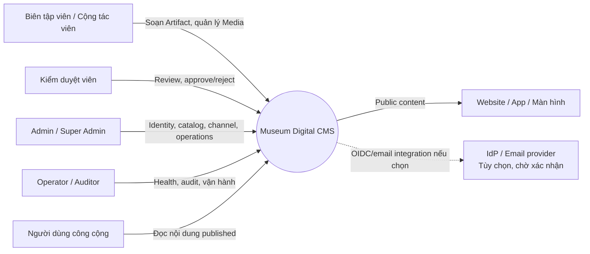
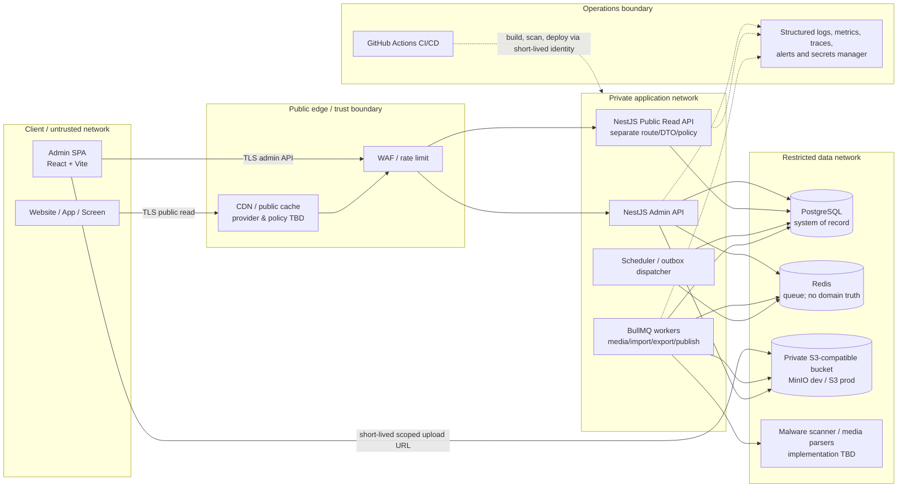
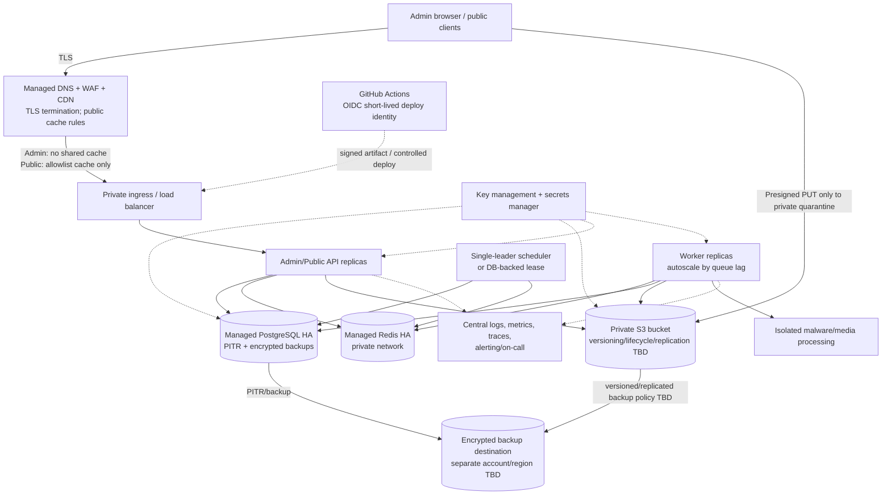

# Museum Digital CMS — Phân tích và kiến trúc Giai đoạn 1

**Trạng thái:** Đã soạn để chủ dự án xem xét; chưa được phê duyệt.
**Phạm vi:** Phân tích và kiến trúc logic. Không phải OpenAPI, migration, kế
hoạch triển khai hay quyết định mua dịch vụ.
**Nguyên tắc đọc:** “Đã xác nhận” chỉ áp dụng cho dữ kiện ghi trong yêu cầu.
“Đề xuất” là khuyến nghị kiến trúc chưa được chủ dự án duyệt. Các con số target
đều là mục tiêu lập kế hoạch, không phải SLA đã cam kết.

## 1. Giả định và ràng buộc

### 1.1 Nguồn và hiện trạng đã đọc

- Đã đọc yêu cầu kiến trúc Museum Digital CMS do chủ dự án cung cấp trong
  phiên này.
- Không tìm thấy `AGENTS.md`, tài liệu architecture/ADR đã lưu trong repository.
- Đã đọc [README.md](../../README.md), [README frontend](../../apps/web/README.md),
  [README backend](../../apps/api/README.md), [README công cụ Python](../../tools/docker-helper/README.md), package manifests,
  [Prisma schema](../../apps/api/prisma/schema.prisma) và
  [Compose](../../infra/docker/docker-compose.yml).
- README trước đây ghi hướng Museum Admin và kiến trúc vận hành cơ bản. Code
  hiện có React/Vite, NestJS, workspace pnpm với packages `apps/web` và
  `apps/api`, một schema `SystemSetting`, và Compose development cho
  PostgreSQL/Redis/MinIO. Có worker mẫu. Chưa thấy `apps/api`, `apps/web`,
  `packages/shared`, OpenAPI contract/client generation, domain entities,
  authentication, workflow hay CI workflow trong tài liệu đã kiểm tra.
- Những gì có trong code là **hiện trạng kỹ thuật**, không được xem là yêu cầu
  nghiệp vụ đã duyệt. Đặc biệt, Prisma, cấu hình UI và đường dẫn workspace trong
  repository không được xem là các lựa chọn cuối cùng cho sản phẩm.
- Lịch sử ADR không được tìm thấy trong repository đã đọc; không suy diễn các
  lựa chọn trước đó thành ADR được chấp thuận.

### 1.2 Bảng giả định và dữ liệu cần xác nhận

Mọi khoảng dưới đây, nếu có, là **planning envelope đề xuất**, không phải số
liệu vận hành hay dự báo. Ước lượng thực tế phải dựa trên inventory/import thử,
telemetry và workload test.

| ID   | Giá trị / khoảng                                                                                                           | Nguồn                                                                    | Cách tính / xác minh                                                                                                        | Ảnh hưởng nếu sai                                                                |
| ---- | -------------------------------------------------------------------------------------------------------------------------- | ------------------------------------------------------------------------ | --------------------------------------------------------------------------------------------------------------------------- | -------------------------------------------------------------------------------- |
| A-01 | Số tài khoản nội bộ: chưa biết; envelope để thử tải: 25–100 tài khoản, 5–25 phiên đồng thời.                               | Chưa xác nhận; envelope đề xuất.                                         | Đếm tài khoản theo vai trò; lấy p95 đồng thời từ log/quan sát pilot.                                                        | Sai sẽ làm sai sizing xác thực, connection pool và license/capacity vận hành.    |
| A-02 | Artifact hiện tại và tăng trưởng năm: chưa biết; chưa đặt envelope.                                                        | Chưa xác nhận.                                                           | Kiểm kê nguồn dữ liệu; đo số bản ghi, tỷ lệ trùng, kế hoạch nhập hàng năm.                                                  | Tác động đến index, import, versioning, lưu trữ và chiến lược search.            |
| A-03 | Media Asset, kích cỡ trung bình/lớn nhất, tổng dung lượng, retention: chưa biết.                                           | Chưa xác nhận.                                                           | Quét inventory; `tổng bytes = Σ kích thước file`; phân nhóm ảnh/video/audio/GLB; thêm tăng trưởng tháng và số bản biến thể. | Sai sẽ gây thiếu storage/bandwidth, thay pipeline và ngân sách backup.           |
| A-04 | Public request rate, peak, quốc gia/địa lý và cache hit: chưa biết.                                                        | Chưa xác nhận.                                                           | Đo analytics/CDN hoặc load test trên tập metadata đại diện; không lấy traffic tổng làm peak.                                | Tác động lựa chọn CDN, cache, DB replicas và SLO public.                         |
| A-05 | SLA/SLO: chưa thống nhất; target lập kế hoạch trong NFR-001 là đề xuất.                                                    | Chưa xác nhận.                                                           | Product/operations chốt availability, latency, cửa sổ bảo trì, đối tượng đo.                                                | Nếu target sai, kiến trúc triển khai/cost và mức dự phòng không phù hợp.         |
| A-06 | RPO/RTO: chưa biết; target lập kế hoạch đề xuất ở NFR-002.                                                                 | Chưa xác nhận.                                                           | Chủ dữ liệu/operations xác định tổn thất dữ liệu chấp nhận được và thời gian khôi phục; diễn tập restore.                   | Có thể cần PITR, bản sao vùng khác, backup object versioning và chi phí cao hơn. |
| A-07 | Retention/backup, legal hold, thời hạn giữ asset gốc và log: chưa biết.                                                    | Chưa xác nhận.                                                           | Đối chiếu quy định pháp lý, hợp đồng license, quy trình lưu trữ bảo tàng và lịch kiểm toán.                                 | Rủi ro xóa sai, vi phạm nghĩa vụ lưu giữ hoặc tăng chi phí storage.              |
| A-08 | Locale giai đoạn 1 là `vi`; có thể mở `en` sau qua cấu hình `SYSTEM_SETTING`. | Ghi chú bổ sung của chủ dự án; chưa có phê duyệt toàn tài liệu. | Xác nhận số locale/kênh thực tế và chính sách fallback với biên tập. | Nếu mở locale mới cần cập nhật Channel, completeness, workflow, URL và search; cấu hình không tự dịch dữ liệu. |
| A-09 | Hệ thống accession number hiện có và quy tắc sinh: chưa biết; uniqueness target là toàn database. | Single-tenant và unique toàn DB theo ghi chú D-01=A1; nguồn mã hiện tại chưa xác nhận. | Kiểm tra registry/import mẫu, format và migration mapping. | Collision khi import vẫn cần giải quyết; nếu accession registry thực tế nhiều namespace, cần đổi constraint trước khi migration. |
| A-10 | Tenancy: single-tenant theo D-01=A1; phân quyền/cơ sở bên trong tenant chưa rõ. | Ghi chú bổ sung của chủ dự án; toàn tài liệu chưa phê duyệt. | Xác nhận cấu trúc tổ chức và phạm vi quyền collection/cơ sở. | Nếu cần multi-tenant, cần tenant key, isolation và uniqueness/index thay đổi xuyên schema. |
| A-11 | Môi trường triển khai, cloud/region, data residency, IdP/SSO: chưa biết.                                                   | Chưa xác nhận.                                                           | Quyết định của chủ dự án/IT/bảo mật và đánh giá nhà cung cấp.                                                               | Tác động auth, backup, DR, object storage, CDN, secrets và CI/CD.                |
| A-12 | Kích cỡ nhóm phát triển, năng lực vận hành 24/7 và ngân sách: chưa biết.                                                   | Chưa xác nhận.                                                           | Xác nhận người trực, kỹ năng, ngân sách và mức managed service.                                                             | Tác động mạnh đến modular monolith, search engine, HA và số thành phần tự quản.  |

### 1.3 Ràng buộc đã xác nhận và điểm mâu thuẫn hiện trạng

Stack cố định theo yêu cầu: NestJS/TypeScript strict; React/Vite/TypeScript
strict; PostgreSQL có migration; S3-compatible (MinIO development, S3
production); presigned upload; BullMQ/Redis; pnpm workspace mục tiêu
`apps/api`, `apps/web`, `packages/shared`; Docker; GitHub Actions. ORM, search,
UI, 3D viewer, rich text editor và public cache còn mở.

Yêu cầu này khác một số thành phần hiện đang có trong repository. Tài liệu này
đề xuất architecture target theo yêu cầu mới, không tự đổi code hoặc tuyên bố
repository đã đạt target. Trước khi chuyển kiến trúc cần chủ dự án xác nhận tài
liệu này và lập kế hoạch chuyển đổi riêng.

### 1.4 Ghi chú quyết định bổ sung từ chủ dự án

Các ràng buộc bổ sung D-01, D-04, D-22, locale và rich-text được ghi nhận tại
Mục 5.2 và ADR-011–014. Đây là đầu vào đã xác nhận cho thiết kế, không đồng
nghĩa toàn bộ tài liệu Phase 1 đã được phê duyệt.

## 2. Yêu cầu

### 2.1 Yêu cầu chức năng

Điều kiện “quyền” ở bảng này là yêu cầu kiểm tra ở server theo deny-by-default,
role và policy tài nguyên; ẩn/hiện giao diện không được tính là kiểm soát truy
cập. Super Admin cũng không được bỏ qua audit hoặc ranh giới pháp lý.

| ID     | Actor                                           | Hành vi                                                                                                                              | Điều kiện quyền                                                                       | Kết quả mong muốn                                                                                                      |
| ------ | ----------------------------------------------- | ------------------------------------------------------------------------------------------------------------------------------------ | ------------------------------------------------------------------------------------- | ---------------------------------------------------------------------------------------------------------------------- |
| FR-001 | Người dùng nội bộ                               | Đăng nhập, đăng xuất, xem phiên đăng nhập, thu hồi phiên.                                                                            | Tài khoản active; rate limit; xác minh thông tin xác thực.                            | Phiên có thể thu hồi; sự kiện đăng nhập được audit; phản hồi không tiết lộ tài khoản tồn tại.                          |
| FR-002 | Admin, Super Admin                              | Thiết lập MFA; bắt buộc MFA cho Admin/Super Admin.                                                                                   | Admin được cấu hình; thao tác nhạy cảm yêu cầu MFA gần đây.                           | MFA recovery an toàn, không lưu secret dạng rõ.                                                                        |
| FR-003 | Admin, Super Admin                              | Tạo/khóa người dùng, gán role/permission, thu hồi refresh session.                                                                   | Quyền user administration; không tự cấp quyền vượt quyền người thao tác.              | Thay đổi có audit actor/target/reason.                                                                                 |
| FR-004 | Admin, Super Admin, Biên tập viên được ủy quyền | Quản lý Catalog/Thesaurus, Term và bản dịch.                                                                                         | Quyền theo catalog; kiểm tra term đang được Artifact sử dụng.                         | Term có định danh ổn định, locale và lịch sử thay đổi.                                                                 |
| FR-005 | Biên tập viên, Cộng tác viên                    | Tạo/sửa Artifact và metadata theo locale.                                                                                            | Quyền create/update trên Artifact/cơ sở/collection; trạng thái cho phép sửa.          | Bản nháp được lưu có version; accession number được kiểm tra unique.                                                   |
| FR-006 | Biên tập viên, Cộng tác viên, Kiểm duyệt viên   | Tìm kiếm Artifact nội bộ, lọc, xem bản dịch và lịch sử.                                                                              | Quyền read cấp đối tượng/collection.                                                  | Chỉ trả dữ liệu người dùng được phép đọc; phân trang ổn định.                                                          |
| FR-007 | Biên tập viên                                   | Liên kết Artifact với Term và Artifact liên quan.                                                                                    | Quyền update cho hai phía; cấm liên kết không hợp lệ/vòng nếu chính sách cấm.         | Liên kết có loại quan hệ, thời điểm và actor/version cần thiết.                                                        |
| FR-008 | Người dùng được cấp quyền Media                 | Tạo upload session, upload trực tiếp, finalize hoặc hủy.                                                                             | Quyền upload, quota, license/case policy; loại và kích thước thuộc allowlist.         | Object riêng tư, key ngẫu nhiên, session hết hạn; file chưa được xác nhận không public.                                |
| FR-009 | Worker                                          | Kiểm tra signature/magic bytes, checksum, malware scan, metadata kỹ thuật và tạo derivatives.                                        | Service identity riêng; chỉ đọc vùng quarantine và ghi vùng processed.                | Asset `ready` chỉ sau toàn bộ policy checks; lỗi quarantine/reject có lý do.                                           |
| FR-010 | Biên tập viên, Admin                            | Quản lý bản quyền/license và ngày hiệu lực/hết hạn.                                                                                  | Quyền update MediaAsset/license; bắt buộc nguồn và phạm vi sử dụng theo policy.       | Không xuất bản khi license không cho phép hoặc hết hạn.                                                                |
| FR-011 | Biên tập viên, Cộng tác viên                    | Nộp Artifact/revision vào workflow, xem assignment.                                                                                  | Quyền submit; version hiện tại không bị stale.                                        | Tạo workflow transition nguyên tử; người nộp không tự approve cùng revision.                                           |
| FR-012 | Kiểm duyệt viên                                 | Approve hoặc reject; reject phải ghi lý do; reassign nếu được phép.                                                                  | Quyền review và độc lập với submitter theo policy.                                    | State machine chặn transition sai; audit, notification và outbox cùng transaction.                                     |
| FR-013 | Biên tập viên, Kiểm duyệt viên                  | Preview revision theo locale/channel.                                                                                                | Quyền preview; draft token ngắn hạn; API không cache shared.                          | Preview cho đúng revision và channel, không rò sang public cache.                                                      |
| FR-014 | Publisher/Admin được ủy quyền                   | Lập lịch publish/unpublish riêng theo Channel, locale, revision.                                                                     | Quyền publish; revision approved; license còn hiệu lực; idempotency key hợp lệ.       | Publication versioned/scheduled; lặp request không tạo bản publish trùng.                                              |
| FR-015 | Publisher/Admin                                 | Gỡ nội dung, archive hoặc hủy lịch.                                                                                                  | Quyền publish; xác nhận trạng thái hiện hành.                                         | Public API và cache invalidation được cập nhật; audit có reason.                                                       |
| FR-016 | Người dùng công cộng                            | Đọc/search nội dung đã published.                                                                                                    | Anonymous chỉ thấy bản published đang có hiệu lực, đúng channel/locale.               | Contract public tách khỏi admin; không trả draft, audit, PII hoặc internal IDs nhạy cảm.                               |
| FR-017 | Admin, Auditor                                  | Tra cứu audit theo actor, resource, action, correlation ID và khoảng thời gian.                                                      | Quyền audit; dữ liệu nhạy cảm được redacted.                                          | Log append-only, truy vấn có phân quyền và retention.                                                                  |
| FR-018 | Hệ thống, người dùng nội bộ                     | Gửi notification trong ứng dụng/email về assignment, review, publish, job và license.                                                | Recipient được xác định theo quyền; email được quản lý theo consent/policy.           | Delivery retry/idempotency; nội dung không lộ dữ liệu vượt quyền.                                                      |
| FR-019 | Admin, Biên tập viên                            | Import CSV/Excel; kiểm tra từng dòng, preview lỗi, xác nhận import.                                                                  | Quyền import theo domain; template/version được xác thực.                             | Job bất đồng bộ, lỗi theo dòng, không commit nửa chừng nếu chọn atomic mode.                                           |
| FR-020 | Admin, Auditor                                  | Export CSV/Excel theo bộ lọc và quyền hiện tại.                                                                                      | Quyền export; giới hạn trường, masking và kiểm toán.                                  | File có expiry/private link; CSV formula injection được giảm thiểu.                                                    |
| FR-021 | Operator                                        | Xem liveness/readiness và trạng thái queue/storage/database.                                                                         | Liveness có thể nội bộ; readiness bảo vệ khỏi public nếu tiết lộ topology.            | Health phân biệt process sống với dependency sẵn sàng; không lộ secret.                                                |
| FR-022 | Admin, Operator                                 | Quản lý cấu hình nghiệp vụ an toàn, retry job, review dead-letter/failure.                                                           | Quyền admin/operator; thao tác nguy hiểm có xác nhận/audit.                           | Không cho chạy code tùy ý hoặc xem secret qua UI.                                                                      |
| FR-023 | Hệ thống                                        | Phát event domain cho index/search, notification và publication qua outbox.                                                          | Chỉ domain owner ghi event; consumer có service identity.                             | Transaction DB và outbox bảo đảm event không mất khi process crash.                                                    |
| FR-024 | Publisher/Operator                              | Phát lại publication/index/cache event sau lỗi.                                                                                      | Quyền vận hành và idempotent replay.                                                  | Retry/replay không tạo state trùng; kết quả quan sát được.                                                             |
| FR-025 | Frontend/backend integrator                     | Dùng OpenAPI làm nguồn contract duy nhất; phát sinh typed client; chuẩn hóa response thành công/lỗi và business error catalog.       | Contract được review/version; CI kiểm compatibility.                                  | Success `{ data, meta }`; error `{ error: { code, message, details, correlationId } }`; không viết tay type trùng API. |
| FR-026 | Người dùng nội bộ/hệ thống                      | Truyền correlation ID qua frontend, API, worker, logs và events; trả lỗi qua Global Exception Filter/API interceptor/Error Boundary. | Correlation ID được validate hoặc tạo mới; không tin giá trị không an toàn từ client. | Lỗi có mã ổn định, stack trace chỉ server-side; không lộ dữ liệu nhạy cảm.                                             |

#### Contract, identity và trạng thái bắt buộc

- OpenAPI là nguồn sự thật duy nhất cho wire contract; frontend typed client được
  sinh tự động. Response success luôn theo `{ data, meta }`; error theo
  `{ error: { code, message, details, correlationId } }`. Business error `code`
  thuộc catalog chung, ổn định qua phiên bản; không trả stack trace, SQL,
  credential hay dữ liệu không được phép. Tất cả input được validate theo
  allowlist tại backend trước khi domain xử lý; frontend validation chỉ phục vụ
  usability. Contract compatibility là CI gate (FR-025–026; NFR-003, NFR-006,
  NFR-008).
- Authentication yêu cầu access JWT ngắn hạn; refresh token rotation qua
  `HttpOnly`, `Secure`, `SameSite` cookie, hash refresh token lưu server-side,
  phát hiện reuse và thu hồi cả token family. MFA bắt buộc Admin/Super Admin.
  Mật khẩu hash Argon2id với salt riêng; parameters được benchmark trên môi
  trường production và lưu trong encoded hash/version. Không tự tạo crypto
  primitive (FR-001–003; NFR-003).
- Role baseline: Super Admin quản trị nền tảng nhưng vẫn bị audit; Admin quản
  lý user/config/domain trong phạm vi được giao; Kiểm duyệt viên review nhưng
  không sửa revision đang review; Biên tập viên tạo/sửa/submit; Cộng tác viên
  sửa scope hẹp và không approve/publish mặc định; Chỉ xem chỉ đọc theo scope.
  Quyền cụ thể được cấu hình qua permission + resource policy, không hardcode
  “role name” thành authorization duy nhất. Public anonymous chỉ đọc published.
- Workflow business state bắt buộc tường minh: `DRAFT → PENDING_REVIEW →
APPROVED → PUBLISHED → UNPUBLISHED/ARCHIVED`. `PENDING_REVIEW → REJECTED`
  cần lý do; bản bị reject về draft qua transition có audit, không sửa lịch sử.
  `PUBLISHED` là trạng thái publication/channel/locale, không phải cờ toàn cục
  của Artifact. Mỗi transition check state, quyền, revision version và
  idempotency trong transaction (FR-011–015; NFR-005–006).
- Không mutable global state. Backend dùng NestJS DI, stateless services,
  request context qua AsyncLocalStorage hoặc `nestjs-cls`; cấu hình có kiểu
  qua `ConfigService` và validate lúc bootstrap. Frontend dùng TanStack Query
  cho server state; state cục bộ theo feature; React Hook Form + Zod cho form.
  Lựa chọn package cụ thể ngoài stack cố định cần ghi ADR trước khi triển khai.
- Backend dùng structured logs; Global Exception Filter, frontend API
  interceptor và Error Boundary chuẩn hóa lỗi. Không log token, secret, upload
  URL, PII hoặc text restricted. Correlation ID đi cùng outbox/job và response.

### 2.2 Yêu cầu phi chức năng

Các mức có chữ “đề xuất” cần được chốt sau khi A-01…A-12 được xác nhận. Chỉ
đo trong môi trường và dataset đã mô tả; không coi local development là nghiệm
thu production.

| ID      | Yêu cầu và tiêu chí đo được                                                                                                                                                                                                                                                                                                                                                                     | Cách nghiệm thu                                                                                                              | Trạng thái                                                         |
| ------- | ----------------------------------------------------------------------------------------------------------------------------------------------------------------------------------------------------------------------------------------------------------------------------------------------------------------------------------------------------------------------------------------------- | ---------------------------------------------------------------------------------------------------------------------------- | ------------------------------------------------------------------ |
| NFR-001 | **Hiệu năng.** Đề xuất p95 admin read/write ≤ 500/800 ms; public metadata read p95 ≤ 300 ms khi cache hit; upload hoàn tất không qua API proxy.                                                                                                                                                                                                                                                 | Load test dataset/peak đã chủ dự án duyệt; đo server p50/p95/p99 và cache hit; tách cold/warm.                               | Target cần xác nhận; phụ thuộc A-01–A-04.                          |
| NFR-002 | **Sẵn sàng/khôi phục.** Đề xuất monthly availability 99.9%; RPO ≤ 15 phút cho PostgreSQL metadata, RPO ≤ 1 giờ cho object nếu chọn replication phù hợp; RTO ≤ 4 giờ.                                                                                                                                                                                                                            | Monitor theo SLI; diễn tập restore DB + object + secrets/config trên môi trường cách ly; ghi thời gian và data loss thực tế. | Target đề xuất; phụ thuộc A-05–A-07 và topology/object versioning. |
| NFR-003 | **Bảo mật.** [OWASP ASVS](https://asvs.owasp.org/) Level 2 làm baseline; 100% route quản trị có auth + permission test; MFA bắt buộc Admin/Super Admin; không có critical/high finding chưa xử lý lúc release. Mật khẩu theo [OWASP Password Storage Cheat Sheet](https://cheatsheetseries.owasp.org/cheatsheets/Password_Storage_Cheat_Sheet.html), Argon2id là lựa chọn bắt buộc trong brief. | Threat model, test authz object-level, SAST/dependency/container scan, pentest theo release.                                 | Baseline yêu cầu; ASVS version và ngoại lệ cần ghi nhận.           |
| NFR-004 | **Dung lượng/tăng trưởng.** Không đặt byte cố định khi chưa có inventory; cảnh báo storage ở 70/85/95% quota đề xuất; derivative/original/retention phải được tính riêng.                                                                                                                                                                                                                       | Dashboard bytes, growth/month, object count, egress, backup growth; so với quota và forecast.                                | Ngưỡng đề xuất; cần A-02/A-03.                                     |
| NFR-005 | **Toàn vẹn.** 100% accession number unique trong phạm vi nghiệp vụ được chốt; tất cả workflow transitions hợp lệ; mọi asset public có scan/license status đạt yêu cầu.                                                                                                                                                                                                                          | Constraint DB, property/state-transition tests, reconciliation job và audit sampling.                                        | Mục tiêu kiểm tra được.                                            |
| NFR-006 | **Truy vết.** 100% admin write/job/publication có correlation ID; 100% state transition ghi actor/system, before/after reference, timestamp và reason khi cần.                                                                                                                                                                                                                                  | Trace/log sampling; kiểm tra không log credentials, token hoặc nội dung restricted.                                          | Mục tiêu đề xuất.                                                  |
| NFR-007 | **Accessibility.** WCAG 2.1 AA cho luồng quản trị và public; không có lỗi critical/serious theo axe ở critical routes; mọi chức năng keyboard-accessible.                                                                                                                                                                                                                                       | Automated scan + keyboard/screen-reader review; kiểm thử viewer 3D có fallback.                                              | Mục tiêu yêu cầu; acceptance detail cần UX/product chốt.           |
| NFR-008 | **Maintainability/CI.** PR bắt buộc lint, typecheck, unit/integration test, contract compatibility, migration check, SCA/SAST; 100% protected branch deploy artifact có provenance.                                                                                                                                                                                                             | GitHub Actions required checks; test branch protection; migration dry-run; SBOM/artifact scan.                               | Pipeline đề xuất, chưa có CI trong repository.                     |
| NFR-009 | **Search quality/freshness.** Đề xuất nội dung public phản ánh Publication hiện hành trong p95 ≤ 60 giây sau publish/unpublish (DB query là nguồn đúng; cache phải invalidated/expiry theo policy); private search không tiết lộ record ngoài permission. | Đo thời gian từ commit đến lần đọc public nhất quán qua CDN; test authorization và Vietnamese relevance corpus do curator tạo. | Target cần xác nhận; A-04/A-08. |
| NFR-010 | **Upload reliability.** Đề xuất ≥ 99.5% upload session hợp lệ hoàn tất hoặc có lỗi chẩn đoán; object chưa finalize tự expire/quarantine theo retention.                                                                                                                                                                                                                                         | Fault injection network/retry; checksum mismatch, malware, orphan-object lifecycle tests.                                    | Target đề xuất; A-03/A-07.                                         |

### 2.3 Truy vết kiến trúc

| Thành phần/thiết kế                                          | Liên kết                                    |
| ------------------------------------------------------------ | ------------------------------------------- |
| Authentication, MFA, RBAC và object policy                   | FR-001–003, NFR-003, NFR-006                |
| Catalog, Artifact, translation và Term hierarchy | FR-004–007, NFR-005, NFR-009 |
| Upload/quarantine/worker/object storage                      | FR-008–010, NFR-003, NFR-004, NFR-010       |
| State machine, audit, transactional outbox và idempotency | FR-011–015, FR-017, FR-023–024, NFR-005–006 |
| Public API, Channel, direct Publication/Revision read và cache/CDN | FR-013–016, NFR-001–003, NFR-009 |
| Notification và import/export                                | FR-018–020, NFR-004, NFR-006                |
| Health/observability/CI                                      | FR-021–022, NFR-002, NFR-006, NFR-008       |
| API contract, typed client, normalized errors và correlation | FR-025–026, NFR-003, NFR-006, NFR-008       |

## 3. Bounded context

### 3.1 Đề xuất kiến trúc và dependency direction

**Đề xuất:** modular monolith NestJS cho API/admin/public domain, với worker
process riêng dùng chung domain modules/contracts. PostgreSQL là system of
record. Tách process worker để scale/failure isolation nhưng không tạo service
boundary/network choreography trước khi có quy mô hoặc yêu cầu độc lập rõ.
Public read API vẫn cùng domain boundary, nhưng route, DTO, authorization,
rate-limit và cache policy riêng.

Dependency direction một chiều (mũi tên nghĩa là “phụ thuộc vào”):

```text
Artifact ──> Identity & Access
Artifact ──> Catalog/Thesaurus
Artifact ──> Media (link/readiness contract)
Workflow ──> Identity & Access
Workflow ──> Artifact revision contract
Publishing ──> Identity & Access
Publishing ──> Workflow approved-revision contract
Publishing ──> Media license/readiness contract
Search ──> Publishing public-read contract (current Publication + Revision)
Import/Export ──> owning-domain public commands/contracts
Notification ──> Identity recipient contract
Domain commands ──> Audit append contract
Domain transactions ──> Outbox (infrastructure port)
Outbox ──> Queue adapters ──> event consumers
```

Mũi tên biểu thị được phép gọi contract/event, không phải quyền đọc bảng của
module khác. `Audit` là append-only sink; lỗi audit của thao tác security-critical
phải fail closed. Outbox publisher/consumer là infrastructure adapter, không
thay thế domain ownership.

### 3.2 Bounded context và quyền sở hữu

| Module            | Trách nhiệm, dữ liệu sở hữu                                                            | API/domain event công khai                                                              | Được phép phụ thuộc                                                                            | Không được truy cập trực tiếp                                                                  |
| ----------------- | -------------------------------------------------------------------------------------- | --------------------------------------------------------------------------------------- | ---------------------------------------------------------------------------------------------- | ---------------------------------------------------------------------------------------------- |
| Identity & Access | User, Role, Permission, UserRole, RolePermission, RefreshSession, MFA state.           | `authorize(actor, action, resource)`; `UserDisabled`, `RoleChanged`.                    | Shared kernel nhỏ; Audit.                                                                      | Không đọc bảng Artifact/Media để tự quyết policy. Domain module không sửa session/auth tables. |
| Catalog/Thesaurus | Catalog, Term, TermTranslation, hierarchy/version.                                     | `TermCreated/Updated/Retired`; lookup contract.                                         | Identity; Audit.                                                                               | Không sửa Artifact/ArtifactTranslation; Artifact tham chiếu ID/contract.                       |
| Artifact          | Artifact, translations, relation, term links, revisions, optimistic version.           | `ArtifactSubmitted`, `ArtifactRevisionApproved` qua Workflow, `ArtifactContentChanged`. | Identity, Catalog, Media link contract, Audit, Outbox.                                         | Không sở hữu file object, license hoặc publish schedule; không ghi trực tiếp Search index.     |
| Media             | MediaAsset, UploadSession, Variant, License, ArtifactMedia; quarantine/scan lifecycle. | create/finalize/cancel upload; `MediaReady`, `MediaRejected`, `LicenseExpired`.         | Identity, Audit, Outbox; worker adapters.                                                      | Không đọc object bằng public path tùy ý; không tự publish Artifact.                            |
| Workflow          | WorkflowInstance, Transition, assignment/review policy, rejection reason.              | `submit`, `approve`, `reject`, `reassign`; `WorkflowApproved/Rejected`.                 | Identity, Artifact revision contract, Audit, Outbox, Notification event.                       | Không sửa Artifact revision nội bộ; gọi domain contract để lock/version-check.                 |
| Publishing        | Channel, Publication, schedule, unpublish, generation; optional public cache/index hints. | `schedule`, `publish`, `unpublish`; `PublicationChanged`.                               | Identity, Workflow approved revision, Media/license readiness, Audit, Outbox.                  | Không query draft tables từ public handler; không bypass Workflow state.                       |
| Search            | Search query/configuration, locale analyzer/relevance metrics; optional search index.     | `searchPublic`, `searchInternal`; optional `IndexUpdated`.                              | Public query over current Publication + ArtifactRevision; Artifact internal read contract; Identity authorization; optional Outbox consumer. | Không là source of truth; không trả content chỉ có trong index; public result phải xác thực publication hiện hành và lấy nội dung canonical từ PostgreSQL. |
| Audit             | AuditEvent append-only, access/query policy.                                           | `record(event)`; `AuditRecorded` (không phát dữ liệu nhạy cảm).                         | Identity actor metadata; application command envelope.                                         | Không cho domain module update/delete audit; không giữ password/token/file contents.           |
| Notification      | Notification và delivery attempts/preferences/template.                                | `notify`, delivery status; consumer domain events.                                      | Identity recipient contract; queue; Outbox.                                                    | Không tự quyết permission/visibility; không làm transaction nguồn của domain.                  |
| Import/Export     | ImportJob, ExportJob, row errors, generated private files.                             | submit/status/cancel; completion/failure events.                                        | Domain commands/contracts, Media private storage, Identity, Audit, Queue.                      | Không insert trực tiếp vào bảng domain hoặc bỏ qua validation/workflow.                        |

### 3.3 Ranh giới và ngăn dependency vòng

- Một NestJS module export application/domain service contract rõ, repository
  chỉ inject bên trong bounded context owner.
- Cấm import repository/entity schema của module khác; tránh shared “god module”.
  Shared package chỉ chứa primitive/contract thật sự chung, không chứa logic
  domain sở hữu.
- Cross-context write qua command contract trong cùng process và cùng
  transaction khi cần atomicity; tác vụ async qua outbox event có schema/version.
  Public query đọc trực tiếp Publication hiện hành + ArtifactRevision bất biến
  theo D-04=E1; search engine/index (nếu chọn) không là authority.
- CI kiểm dependency graph/module boundary (ví dụ rule import allowlist và
  graph check); review dependency direction trong PR. Nếu phát sinh cycle, tách
  contract hoặc domain event, không giải quyết bằng forward reference.
- Public API không dùng chung DTO với admin nếu field exposure khác nhau.
- Liên kết: FR-003–024; NFR-003, NFR-005, NFR-006, NFR-008.

## 4. Kiến trúc

### 4.1 C4 Level 1 — System Context



**Trust boundaries:** internal workforce, anonymous public, privileged
operator, third-party IdP/email và S3-compatible storage là vùng trust khác
nhau. Public không kết nối database/Redis trực tiếp. IdP và production cloud
provider chưa được xác nhận. (FR-001–024; NFR-003, NFR-006)

### 4.2 C4 Level 2 — Containers



**Ranh giới:** Admin/Public API có contract và policy tách; chưa chắc cần hai
deployment riêng ở giai đoạn đầu. Public CDN chỉ được cache allowlisted public
representation; draft/admin luôn `private, no-store`. API và worker dùng
identity khác nhau; DB credentials least privilege; worker chỉ có quyền object
quarantine/process phù hợp. Browser nhận URL ký hẹp, không nhận credential
bucket. Redis không được truy cập từ public. Secrets do secrets manager cấp,
không đưa vào image/repository. OpenTelemetry-compatible observability là đề
xuất; vendor chưa chốt. (FR-008–024; NFR-001–006)

**Cố định theo yêu cầu:** NestJS, React/Vite, PostgreSQL, S3-compatible,
presigned upload, BullMQ/Redis, pnpm workspace, Docker, GitHub Actions.
**Chờ chủ dự án chốt:** ORM, search backend, UI library, 3D viewer, rich text,
public cache strategy, IdP/cloud/observability provider. (NFR-003, NFR-008)

### 4.3 Sơ đồ triển khai production (đề xuất, provider-agnostic)



Đây là topology logic, không chọn cloud vendor, region, tier hay HA topology.
Production phải xác nhận data residency, encryption/key ownership, backup
isolation, S3 versioning/lifecycle, Redis persistence, public invalidation và
on-call. Read replicas chỉ thêm nếu telemetry chứng minh cần; không dùng Redis
làm nguồn xác thực của publication. (NFR-001–006, NFR-008)

### 4.4 Luồng dữ liệu

1. **Upload Media Asset:** editor được authorize theo artifact/collection;
   API tạo `UploadSession` với object key không đoán được, expected checksum,
   size/type allowlist và expiry. Browser PUT thẳng vào private quarantine.
   API finalize dùng HEAD/checksum/version; outbox enqueue scan. Worker xác
   minh magic bytes, malware scan, checksum, metadata, license constraints và
   derivatives; transaction cập nhật status và audit. Chỉ `ready` mới cho
   preview/public theo policy. Session bỏ dở hết hạn và object quarantine được
   lifecycle dọn. (FR-008–010; NFR-003, NFR-004, NFR-010)
2. **Soạn và kiểm duyệt:** user tạo revision có `expectedVersion`; Artifact
   owner validate catalog/media references và ghi revision. Submit transaction
   tạo workflow instance/transition + outbox. Reviewer độc lập approve/reject;
   approve/reject kiểm tra state, authorization, revision version và reason;
   concurrent update trả conflict chứ không ghi đè. (FR-005–007, FR-011–012;
   NFR-005–006)
3. **Xuất bản nhiều Channel:** publisher chỉ chọn revision approved, locale,
   channel và license hợp lệ. Mỗi lần publish tạo Publication generation mới
   cùng idempotency record; scheduler dùng DB transaction/lease chuyển sang
   effective state. Outbox thông báo optional search index và cache invalidation.
   Public read lấy nội dung trực tiếp từ Publication + ArtifactRevision theo
   D-04=E1. Unpublish phải invalidate CDN; cache TTL là defense-in-depth, không
   thay invalidation. (FR-014–015, FR-023–024; NFR-001, NFR-003, NFR-009)
4. **Public read qua cache:** client gọi public API qua WAF/CDN. CDN chỉ cache
   response public với cache key bao gồm channel/locale/representation version;
   cache miss/origin read join trực tiếp Publication hiện hành với
   ArtifactRevision bất biến, lọc theo channel/locale. Không dùng cache public
   cho preview, draft, quyền cá nhân hoặc response có cookie/auth. Unpublish
   ghi invalidation event; nếu CDN không xác nhận purge thì nội dung public cũ
   có thể stale trong TTL được duyệt, nhưng draft/private content tuyệt đối
   không được serve stale. (FR-013, FR-016; NFR-001, NFR-003, NFR-009)

### 4.5 Sequence — presigned upload và xử lý nền

```mermaid
sequenceDiagram
  autonumber
  actor E as Editor
  participant UI as Admin SPA
  participant API as NestJS API
  participant DB as PostgreSQL
  participant S3 as Private quarantine bucket
  participant O as Outbox/Dispatcher
  participant Q as Redis/BullMQ
  participant W as Isolated worker
  participant AV as AV/parser
  participant Audit as Audit

  E->>UI: Chọn file, artifact, checksum/metadata
  UI->>API: POST upload session + correlation/idempotency key
  API->>API: Authenticate; validate allowlist, quota, scope
  API->>API: Authorize upload at resource level
  API->>DB: Transaction: create MediaAsset(PENDING_UPLOAD), UploadSession, idempotency record
  API->>S3: Sign scoped PUT for random quarantine object key + short expiry
  API->>Audit: Record session created (same transaction/outbox)
  API-->>UI: Upload URL, required headers, expiry, session ID
  UI->>S3: PUT bytes directly; checksum header if supported
  S3-->>UI: Upload result / ETag (not trusted as sole checksum)
  UI->>API: POST finalize(session ID, idempotency key, observed checksum)
  API->>API: Re-check actor/session ownership and expiry
  API->>S3: HEAD exact key/version; verify size and metadata
  API->>DB: Transaction: CAS session state; add ScanRequested outbox event
  API->>Audit: Record finalize request and correlation ID
  O->>Q: Enqueue scan job with stable job/idempotency identity
  Q->>W: Deliver job (at-least-once)
  W->>S3: Read quarantine object by exact version
  W->>W: Recompute cryptographic checksum; inspect magic bytes/size
  W->>AV: Scan in isolated, resource-limited environment
  AV-->>W: Clean / malicious / timeout / parser error
  alt Clean and policy/license valid
    W->>W: Create safe derivatives; strip unsafe metadata as policy requires
    W->>S3: Write processed variants, never overwrite original
    W->>DB: Transaction: mark READY, variants, transition, OutboxEvent
    W->>Audit: Record scan result/status and correlation ID
    Note over API,UI: Preview allowed only after READY and access policy check
    Note over API,S3: Public delivery additionally requires approved publication, active license and channel policy
  else Malware, invalid signature, checksum mismatch, or prohibited content
    W->>S3: Keep in restricted quarantine or delete per legal retention policy
    W->>DB: Mark REJECTED; record reason code; prevent preview/public
    W->>Audit: Record rejection, scanner version and correlation ID
  else Transient infrastructure/parser timeout
    W->>Q: Throw retryable Error; bounded exponential retry
    Note over Q,W: Idempotent processor; after retry limit, alert/dead-letter for review
  end
  Note over UI,S3: Expired/abandoned session: deny finalize; lifecycle cleanup + audit
```

Presigned URL là bearer capability: response không log URL, URL ngắn hạn/one
object key/one method; enforce expected size/checksum where storage supports it;
session binds user/resource/key/version. Replay cannot overwrite a different
asset because keys are unique; if same-key overwrite remains possible, finalize
pins exact version or rejects changed checksum. No asset is previewable/public
until asynchronous validation reaches `READY` and domain publication gates pass.
Outbox + idempotent consumer tolerate at-least-once delivery; queue retry policy
does not imply exactly-once execution. (FR-008–010, FR-023–024; NFR-003,
NFR-005–006, NFR-010)

## 5. Mô hình dữ liệu

### 5.1 ERD logic (không phải schema/migration cuối)

Các kiểu là logical PostgreSQL-oriented types, không bắt buộc ORM. `UUID` là
khóa nội bộ; `JSONB` chỉ dùng cho payload có schema/version rõ, không thay thế
các trường cần ràng buộc hoặc truy vấn. Cột `version` dùng optimistic locking.
Bảng có `deleted_at` được soft-delete trừ khi ghi chú khác.

```mermaid
erDiagram
  USER {
    uuid id PK
    citext email UK
    text password_hash
    text display_name
    text status
    boolean mfa_required
    bytea mfa_secret_encrypted
    timestamptz mfa_enrolled_at
    timestamptz created_at
    timestamptz updated_at
    timestamptz deleted_at
    int version
  }
  ROLE {
    uuid id PK
    text code UK
    text name
    timestamptz deleted_at
  }
  PERMISSION {
    uuid id PK
    text code UK
    text description
  }
  USER_ROLE {
    uuid user_id PK,FK
    uuid role_id PK,FK
    uuid granted_by FK
    timestamptz granted_at
  }
  ROLE_PERMISSION {
    uuid role_id PK,FK
    uuid permission_id PK,FK
  }
  SYSTEM_SETTING {
    text scope PK
    text key PK
    jsonb value
    boolean is_secret
    uuid updated_by FK
    timestamptz updated_at
  }
  REFRESH_SESSION {
    uuid id PK
    uuid user_id FK
    bytea token_hash UK
    uuid family_id
    timestamptz expires_at
    timestamptz revoked_at
    inet created_ip
    timestamptz created_at
  }
  CATALOG {
    uuid id PK
    text code UK
    text name
    text status
    int version
  }
  TERM {
    uuid id PK
    uuid catalog_id FK
    uuid parent_id FK
    text code
    text status
    timestamptz deleted_at
    int version
  }
  TERM_TRANSLATION {
    uuid term_id PK,FK
    text locale PK
    text label
    text description
  }
  ARTIFACT {
    uuid id PK
    text accession_number UK
    text status
    uuid created_by FK
    timestamptz created_at
    timestamptz updated_at
    timestamptz deleted_at
    int version
  }
  ARTIFACT_TRANSLATION {
    uuid artifact_id PK,FK
    text locale PK
    text title
    text description_format
    jsonb description_rich
    text description_text
    text period
    text material
    jsonb dimensions
    text provenance
    text conservation_state
    jsonb structured_metadata
    int version
  }
  ARTIFACT_RELATION {
    uuid id PK
    uuid source_artifact_id FK
    uuid target_artifact_id FK
    text relation_type
    uuid created_by FK
    timestamptz created_at
  }
  ARTIFACT_TERM {
    uuid artifact_id PK,FK
    uuid term_id PK,FK
    uuid assigned_by FK
  }
  ARTIFACT_REVISION {
    uuid id PK
    uuid artifact_id FK
    int revision_number
    jsonb snapshot
    uuid created_by FK
    text change_summary
    timestamptz created_at
    text content_hash
  }
  MEDIA_ASSET {
    uuid id PK
    text asset_type
    text status
    text original_key UK
    text original_version_id
    text checksum_sha256
    bigint byte_size
    text detected_mime
    uuid license_id FK
    timestamptz retention_until
    timestamptz created_at
    timestamptz deleted_at
    int version
  }
  UPLOAD_SESSION {
    uuid id PK
    uuid asset_id FK
    uuid user_id FK
    text object_key UK
    text expected_sha256
    bigint expected_size
    timestamptz expires_at
    text state
    uuid idempotency_record_id FK
    timestamptz created_at
  }
  IDEMPOTENCY_RECORD {
    uuid id PK
    uuid actor_id FK
    text operation
    text idempotency_key
    text request_hash
    jsonb response_snapshot
    timestamptz created_at
    timestamptz expires_at
  }
  MEDIA_VARIANT {
    uuid id PK
    uuid asset_id FK
    text variant_type
    text object_key UK
    text object_version_id
    text checksum_sha256
    bigint byte_size
    text mime_type
    text processing_state
    timestamptz created_at
  }
  MEDIA_LICENSE {
    uuid id PK
    text rights_holder
    text license_code
    text scope
    timestamptz valid_from
    timestamptz valid_until
    text evidence_key
    text status
    int version
  }
  ARTIFACT_MEDIA {
    uuid artifact_id PK,FK
    uuid asset_id PK,FK
    text usage_role PK
    int display_order
    uuid linked_by FK
    timestamptz linked_at
  }
  WORKFLOW_INSTANCE {
    uuid id PK
    uuid artifact_id FK
    uuid revision_id FK
    text state
    uuid assignee_id FK
    uuid submitted_by FK
    timestamptz submitted_at
    timestamptz completed_at
    int version
  }
  WORKFLOW_TRANSITION {
    uuid id PK
    uuid instance_id FK
    text from_state
    text to_state
    uuid actor_id FK
    text reason
    text correlation_id
    timestamptz created_at
  }
  CHANNEL {
    uuid id PK
    text code UK
    text name
    text status
    int version
  }
  CHANNEL_LOCALE {
    uuid channel_id PK,FK
    text locale PK
    boolean enabled
  }
  PUBLICATION {
    uuid id PK
    uuid artifact_id FK
    uuid revision_id FK
    uuid channel_id FK
    text locale
    int generation
    text state
    timestamptz scheduled_at
    timestamptz published_at
    timestamptz unpublished_at
    uuid idempotency_record_id FK
    int version
  }
  AUDIT_EVENT {
    uuid id PK
    text actor_type
    uuid actor_id FK
    text action
    text resource_type
    uuid resource_id
    text correlation_id
    text reason
    jsonb redacted_changes
    timestamptz occurred_at
  }
  NOTIFICATION {
    uuid id PK
    uuid recipient_id FK
    text event_type
    jsonb payload
    timestamptz read_at
    timestamptz created_at
  }
  NOTIFICATION_DELIVERY {
    uuid id PK
    uuid notification_id FK
    text channel
    text state
    int attempts
    timestamptz next_attempt_at
    timestamptz sent_at
    text provider_message_id
  }
  IMPORT_JOB {
    uuid id PK
    uuid submitted_by FK
    text format
    text state
    text template_version
    text object_key
    int total_rows
    int valid_rows
    int failed_rows
    timestamptz created_at
    timestamptz completed_at
  }
  IMPORT_ROW_ERROR {
    uuid id PK
    uuid import_job_id FK
    int row_number
    text field_name
    text error_code
    text safe_message
    jsonb redacted_input
  }
  EXPORT_JOB {
    uuid id PK
    uuid submitted_by FK
    text state
    jsonb filter_snapshot
    text object_key
    timestamptz expires_at
    timestamptz created_at
    timestamptz completed_at
  }
  OUTBOX_EVENT {
    uuid id PK
    text aggregate_type
    uuid aggregate_id
    text event_type
    int schema_version
    jsonb payload
    text correlation_id
    text idempotency_key UK
    timestamptz occurred_at
    timestamptz published_at
    int attempts
  }

  USER ||--o{ USER_ROLE : assigned
  ROLE ||--o{ USER_ROLE : grants
  ROLE ||--o{ ROLE_PERMISSION : includes
  PERMISSION ||--o{ ROLE_PERMISSION : granted
  USER o|--o{ SYSTEM_SETTING : updates
  USER ||--o{ REFRESH_SESSION : owns
  CATALOG ||--o{ TERM : contains
  TERM ||--o{ TERM : parent
  TERM ||--o{ TERM_TRANSLATION : translated
  USER ||--o{ ARTIFACT : creates
  ARTIFACT ||--o{ ARTIFACT_TRANSLATION : translated
  ARTIFACT ||--o{ ARTIFACT_REVISION : versions
  ARTIFACT ||--o{ ARTIFACT_RELATION : source
  ARTIFACT ||--o{ ARTIFACT_RELATION : target
  ARTIFACT ||--o{ ARTIFACT_TERM : classified
  TERM ||--o{ ARTIFACT_TERM : classifies
  MEDIA_LICENSE ||--o{ MEDIA_ASSET : governs
  MEDIA_ASSET ||--o{ UPLOAD_SESSION : staged
  USER ||--o{ UPLOAD_SESSION : starts
  USER ||--o{ IDEMPOTENCY_RECORD : acts
  IDEMPOTENCY_RECORD ||--o{ UPLOAD_SESSION : guards
  IDEMPOTENCY_RECORD ||--o{ PUBLICATION : guards
  MEDIA_ASSET ||--o{ MEDIA_VARIANT : derives
  ARTIFACT ||--o{ ARTIFACT_MEDIA : links
  MEDIA_ASSET ||--o{ ARTIFACT_MEDIA : attached
  ARTIFACT ||--o{ WORKFLOW_INSTANCE : reviewed
  ARTIFACT_REVISION ||--o{ WORKFLOW_INSTANCE : evaluates
  WORKFLOW_INSTANCE ||--o{ WORKFLOW_TRANSITION : transitions
  CHANNEL ||--o{ PUBLICATION : receives
  CHANNEL ||--o{ CHANNEL_LOCALE : enables
  CHANNEL_LOCALE ||--o{ PUBLICATION : permits_locale
  ARTIFACT ||--o{ PUBLICATION : publishes
  ARTIFACT_REVISION ||--o{ PUBLICATION : publishes_revision
  USER o|--o{ AUDIT_EVENT : performs
  USER ||--o{ NOTIFICATION : receives
  NOTIFICATION ||--o{ NOTIFICATION_DELIVERY : delivered
  USER ||--o{ IMPORT_JOB : submits
  IMPORT_JOB ||--o{ IMPORT_ROW_ERROR : reports
  USER ||--o{ EXPORT_JOB : submits
```



`USER`, `ARTIFACT`, `MEDIA_ASSET`, `WORKFLOW_INSTANCE`, `PUBLICATION` và
`OUTBOX_EVENT` quan hệ với `AUDIT_EVENT`/events bằng polymorphic resource
identity; không thêm FK đa hình giả. `WORKFLOW_TRANSITION.actor_id`,
`WORKFLOW_INSTANCE.assignee_id`, `submitted_by`, các `*_by` và `USER_ROLE`
grantor có FK tới `USER`. `OUTBOX_EVENT` không chứa credential hoặc file bytes.

### 5.2 Constraint và index quan trọng

- **Identity:** unique normalized `lower(email)` (hoặc `citext` nếu ORM/driver
ổn định); unique `Role.code`, `Permission.code`,
  `(user_id, role_id)`, `(role_id, permission_id)`; index session theo
  `(user_id, revoked_at, expires_at)`; chỉ lưu hash refresh token.
- **Catalog/locale:** unique `(catalog_id, code)`, `(term_id, locale)` và
`(channel_id, locale)`; Phase 1 chỉ bật `vi`; có thể bật `en` sau qua
`SYSTEM_SETTING`. Locale phải theo allowlist đã cấu hình; parent không tự
tham chiếu chính nó.
- **Term hierarchy:** chặn cycle sâu (ví dụ A→B→A) bằng recursive check ở app
trong transaction; serialize hierarchy writes theo catalog (row/advisory lock)
để tránh hai transaction đồng thời tạo cycle mà mỗi transaction riêng lẻ
không nhìn thấy. Integration test cho cycle và concurrent cycle là bắt buộc.
PostgreSQL không có constraint built-in cho recursive cycle; dùng closure
table hoặc materialized path nếu subtree query cần tối ưu.
- **Artifact:** D-01=A1 xác định single-tenant; accession number unique toàn
database. Không để soft-delete vô hiệu hóa collision nếu chưa có policy cho
phép tái sử dụng. Index `(status, updated_at, id)`,
`(artifact_id, locale)`, relation `(source_artifact_id, relation_type)` và
`(target_artifact_id)`.
- **Rich text:** `ARTIFACT_TRANSLATION.description_format` chỉ nhận allowlist;
Phase 1 là `prosemirror_json`. `description_rich` validate ProseMirror schema
khi nhận và trước khi render; `description_text` đồng bộ từ rich text trong
cùng transaction và phục vụ FTS. Editor UI vẫn là quyết định mở; không được
lưu HTML không sanitize hoặc tin client-generated plain text.
- **Revision/workflow:** unique `(artifact_id, revision_number)`;
index `(state, assignee_id, submitted_at)`; transition index
`(instance_id, created_at)`; check rejection `to_state='REJECTED'` đòi
`reason` không rỗng. Transition chỉ insert, không update.
- **Media:** unique object key; checksum SHA-256 lowercase hex hoặc bytea nhất
quán; không unique checksum toàn cục nếu policy cho phép bản sao; index
`(status, created_at)`, `(license_id, status)`, `checksum_sha256`,
`retention_until`, variant `(asset_id, variant_type)`. Byte size > 0 và
quota enforce ở app level cùng storage limits.
- **Idempotency:** `IDEMPOTENCY_RECORD` có unique
`(actor_id, operation, idempotency_key)`; `request_hash` phát hiện cùng key
nhưng payload khác; cleanup sau 7 ngày theo D-22. `UPLOAD_SESSION` và
`PUBLICATION` tham chiếu record qua FK optional; không đặt unique key global
lên bảng nghiệp vụ. `response_snapshot` chỉ giữ kết quả ổn định, không giữ
presigned URL/secret; URL upload được cấp lại sau khi re-authorize session.
- **Upload session:** unique `object_key`; index `(state, expires_at)`; finalize
dùng compare-and-swap (CAS) trên `state`/`version`.
- **Publication/schedule:** mỗi lần publish tạo row mới với `generation` tăng;
unique `(artifact_id, channel_id, locale, revision_id, generation)`;
partial unique `(artifact_id, channel_id, locale) WHERE state='PUBLISHED'`
bảo đảm tối đa một publication active cho một artifact/channel/locale.
Unpublish rồi republish tạo generation mới; lịch sử publish nằm trong
`PUBLICATION`. Index `(state, scheduled_at)` cho scheduler và
`(channel_id, locale, state, published_at)` cho public lookup.
- **Channel locale consistency:** `PUBLICATION.locale` phải nằm trong
`CHANNEL_LOCALE` có `enabled=true`; enforce bằng composite FK
`(channel_id, locale)` tới `CHANNEL_LOCALE`, không chỉ app-level check.
- **Audit/correlation:** `actor_type ∈ {USER, SYSTEM, WORKER}`; `actor_id`
nullable chỉ khi `actor_type != 'USER'`, và bắt buộc có khi `actor_type =
'USER'` (DB check constraint). Index
`(resource_type, resource_id, occurred_at)`, `(actor_id, occurred_at)`,
`correlation_id`, `occurred_at`; partition theo thời gian sau khi volume đo
được. Dùng append-only DB role và archive policy.
- **System setting:** unique `(scope, key)`; khi `is_secret=true`, API/UI không
đọc raw value mà chỉ trả masked representation; mọi update gắn actor và audit.
D-01 single-tenant nên Phase 1 chỉ cần global scope; việc thêm scope khác
cần quyết định lại tenancy. Không lưu credential vận hành nếu có thể dùng
secrets manager; nếu nghiệp vụ thực sự cần secret trong setting, mã hóa
envelope với KMS/key tách khỏi DB và không trả raw value qua bất kỳ API nào.
Danh sách locale được bật là cấu hình allowlist có kiểm soát; chỉ thêm `en`
khi đã cấu hình bản dịch và locale tương ứng cho từng Channel.
- **Notification/import/export:** index `(recipient_id, read_at, created_at)`,
`(state, next_attempt_at)`; import unique
`(import_job_id, row_number, field_name, error_code)` khi deduplicate; export
expiry index.
- **Outbox:** unique event `idempotency_key`; partial index
`published_at IS NULL, occurred_at`; claim bằng lease/`SKIP LOCKED` có
timeout, không giữ transaction mở khi gọi Redis. Retention 90 ngày theo D-22;
cleanup định kỳ sau khi event được publish và không còn cần điều tra/replay.
- **Search/public query:** nội dung public đọc trực tiếp bằng join hiện hành
`PUBLICATION + ARTIFACT_REVISION` theo D-04=E1, lọc `state='PUBLISHED'`,
thời gian hiệu lực, Channel và locale enabled; không phụ thuộc projection
để xác định quyền/nội dung được phát hành. `description_text` là nguồn tạo
FTS; FTS/trigram index và search engine cho truy vấn public/internal vẫn chờ
đánh giá ở Mục 6. Nếu search engine trả candidate IDs thì query cuối vẫn
phải validate publication/revision từ PostgreSQL.

### 5.3 Chính sách dữ liệu và lifecycle

- **Soft-delete:** dùng `deleted_at` cho Artifact/Media/User khi khôi phục,
  audit hoặc retention yêu cầu. Soft-delete ẩn khỏi normal query nhưng không
  thu hồi tự động publication, object URL, search index (nếu có) hay FK; phải
  có workflow xóa/gỡ liên quan. Hard-delete chỉ theo retention/legal-hold
  policy, xác nhận backup expiry, purge derivatives/search/cache, và audit
  tombstone.
  Credential/session secrets được purge khi cần; audit không xóa trái quy định.
- **Versioning:** ArtifactRevision là snapshot bất biến của nội dung đã submit
  hoặc thay đổi quan trọng; Artifact giữ current draft state. Chọn snapshot
  (thay vì chỉ diff) để restore/review dễ và để Publication trỏ revision bất
  biến. Snapshot cần canonical serialization, schema version và retention.
  Quyết định chi tiết snapshot frequency còn cần duyệt.
- **i18n:** bảng translation riêng cho Artifact/Term giúp unique locale,
  completeness/reporting và search per-locale. JSONB chỉ phù hợp metadata mở
  rộng đã có validation schema/version, không dùng cho các trường cốt lõi.
  Locale và rich-text constraints được nêu tại Mục 5.2; editor UI vẫn là quyết
  định mở.
- **Optimistic locking:** update nhận `expectedVersion`; `UPDATE ... WHERE
version = expectedVersion`, increment version trong transaction; 0 row
  affected trả conflict (HTTP 409 theo contract sau này), UI yêu cầu reload
  hoặc merge; không silent last-write-wins.
- **UUID và accession:** UUID ngẫu nhiên nội bộ tránh lộ sequence, giúp import
  idempotent; accession number là business identifier, nhập/gán theo policy,
  unique và immutable sau khi công bố trừ quy trình sửa có audit.
- **Media state:** `PENDING_UPLOAD → UPLOADED → SCANNING → PROCESSING →
READY`; nhánh `REJECTED`, `EXPIRED`, `DELETED`. `READY` cần checksum khớp,
  magic bytes/MIME allowlist, malware scan sạch, variants policy đạt và license
  hợp lệ. Public thêm điều kiện approved revision + active publication.
- **Object retention:** object keys/version IDs/checksum/variant metadata lưu
  trong DB; original immutable/private, variants derivative riêng, quarantine
  bucket prefix hoặc bucket riêng. Lifecycle xóa orphan/expired multipart theo
  policy đã duyệt; bản gốc giữ theo policy bảo tồn/license/legal hold. S3
  versioning và backup không được coi là cùng một thứ; restore phải đối chiếu
  DB/object manifest.
- **Idempotency/outbox behavior:** trong thời hạn lưu record, cùng key và
  request hash trả lại kết quả đã lưu; khác hash trả conflict, không thực thi
  lần hai. Upload URL không được cache trong response; sau re-authorization có
  thể mint URL mới cho session/key còn hợp lệ. Chỉ cleanup outbox event sau
  publish và khi không còn cần cho replay/điều tra. Backup retention là policy
  độc lập với TTL của các record này.
- **ORM chưa chốt:** ERD là logical model. Cú pháp migration, transaction
  isolation, partial indexes, extension `pg_trgm`, exclusion/unique constraints
  và RLS (nếu cần) phải chứng minh được bằng spike với ORM được chọn. Không lấy
  schema hiện tại trong repository làm schema CMS cuối.

Liên kết: FR-003–024; NFR-003–006, NFR-009–010.

## 6. Quyết định mở

Các mô tả khả năng dưới đây là thông tin từ tài liệu chính thức được dẫn; đánh
giá phù hợp là suy luận kiến trúc cho bối cảnh hiện tại, chưa được chủ dự án
phê duyệt. Phiên bản/capability có thể thay đổi; xác minh lại khi quyết định và
pin version trong ADR implementation sau này.

| Lựa chọn                              | Ưu / nhược và vận hành/bảo mật                                                                                                                                                                                                                                                                                                                             | Phù hợp với yêu cầu                                                                                                                     | Khuyến nghị kiến trúc sư                                                                                                                                          | Trạng thái          |
| ------------------------------------- | ---------------------------------------------------------------------------------------------------------------------------------------------------------------------------------------------------------------------------------------------------------------------------------------------------------------------------------------------------------- | --------------------------------------------------------------------------------------------------------------------------------------- | ----------------------------------------------------------------------------------------------------------------------------------------------------------------- | ------------------- |
| **ORM: Prisma**                       | Tài liệu mô tả Prisma Client sinh type-safe query builder và Prisma Migrate ([Prisma ORM](https://www.prisma.io/docs/orm/v6/overview/introduction/what-is-prisma)). Schema sinh code/migration rõ; cần thử nghiệm constraint nâng cao, SQL đặc thù/extension và cách workflow module tổ chức transaction. Generated client phải khớp migration khi deploy. | Có ích cho NestJS/TS strict, quan hệ Artifact/translation và onboarding; cần spike pg_trgm, partial index, outbox locking và extension. | Shortlist ưu tiên nếu spike SQL nâng cao và transaction qua domain boundary đạt. Không chốt trước POC.                                                            | Chờ chủ dự án chốt. |
| **ORM: TypeORM**                      | Tài liệu chính thức nêu Data Mapper/Active Record, TypeScript, nhiều DB, QueryBuilder và migrations ([TypeORM](https://typeorm.io/)). QueryBuilder linh hoạt; entity/repository decorators có thể làm mờ owner khi share entity và cần discipline migration/runtime.                                                                                       | Phù hợp nếu nhóm cần mapping entity/unit-of-work hoặc query builder phức tạp; discipline modular boundary là bắt buộc.                  | Đưa vào POC so sánh với Prisma; test migration diff, Postgres-specific SQL, transaction/outbox và type safety thực tế.                                            | Chờ chủ dự án chốt. |
| **Search: PostgreSQL FTS**            | PostgreSQL có full-text search, parser/configuration, ranking/index theo tài liệu ([Text Search](https://www.postgresql.org/docs/current/textsearch.html)). Ít dịch vụ hơn; cạnh tranh tải search/write và chất lượng tiếng Việt/tokenization là rủi ro. pg_trgm hỗ trợ similarity riêng, không thay ngôn ngữ analyzer.                                    | Khởi đầu tốt nếu corpus/traffic vừa phải và tìm kiếm tiếng Việt đạt test curator. Search transactional freshness có lợi.                | Khởi đầu bằng POC corpus thật; chỉ chốt sau relevance eval Vietnamese, query latency và write contention test.                                                    | Chờ chủ dự án chốt. |
| **Search: Meilisearch**               | Tài liệu mô tả index riêng, full-text/semantic search, typo tolerance/facets và self-host/cloud ([Meilisearch overview](https://www.meilisearch.com/docs/getting_started/overview)). Thêm vận hành, đồng bộ index, ACL/search leakage và eventual consistency; PostgreSQL vẫn là source of truth.                                                     | Hữu ích khi typo tolerance/faceting/instant search là ưu tiên đã đo; private search cần filter/authz mạnh.                              | Nếu chọn, index chỉ trả candidate IDs; hydrate/authorize qua PostgreSQL và public read vẫn kiểm Publication hiện hành + ArtifactRevision theo D-04=E1. Không cần projection để xác định public state. | Chờ chủ dự án chốt. |
| **UI: MUI**                           | Component library React production-oriented và nhiều component/cấu hình theo tài liệu ([MUI](https://mui.com/material-ui/getting-started/)). Tốc độ triển khai cao; design language và customization có thể tăng bundle/độ phụ thuộc vào API library. A11y vẫn phải test.                                                                                  | Admin data-heavy forms/tables phù hợp; cần xác nhận design system/branding và component licensing cần thiết.                            | Shortlist nếu team muốn component package và năng suất đồng nhất.                                                                                                 | Chờ chủ dự án chốt. |
| **UI: shadcn/ui + Radix**             | shadcn tự mô tả không phải component library đóng gói mà là cách phân phối source để sửa/composition ([shadcn/ui](https://ui.shadcn.com/docs)); Radix primitives cần đội tự duy trì component/source/style. Linh hoạt, minh bạch; tăng trách nhiệm cập nhật, consistency và regression tests.                                                              | Tốt khi cần custom design system và team sẵn sàng sở hữu component. Có một Button mẫu trong repo nhưng chưa là quyết định sản phẩm.     | So sánh với MUI qua prototype critical flows + keyboard/axe test; không suy diễn từ code hiện tại.                                                                | Chờ chủ dự án chốt. |
| **3D: Three.js thuần**                | API 3D low-level/web rendering, tài liệu chính thức cung cấp API/reference ([Three.js docs](https://threejs.org/docs/)). Ít abstraction React; nhóm kiểm soát lifecycle/resource disposal nhưng tự tích hợp state/loading/controls.                                                                                                                        | Phù hợp khi viewer là widget độc lập, performance/lifecycle kiểm soát bởi kỹ sư 3D.                                                     | Lựa chọn cơ sở nếu nhóm có năng lực 3D/WebGL và muốn tách viewer khỏi state React.                                                                                | Chờ chủ dự án chốt. |
| **3D: React Three Fiber**             | Tài liệu nêu đây là React renderer cho Three.js và ghép major version với React; docs hiện ghi v10 alpha ([R3F](https://r3f.docs.pmnd.rs/getting-started/introduction)). Ergonomic với React; dependency/version compatibility và performance/device vẫn cần benchmark.                                                                                    | Hợp team React nếu workload GLB vừa phải và pairing React 19/phiên bản stable được xác nhận.                                            | POC với thiết bị yếu, GLB lớn, keyboard alternative; không dùng alpha cho production baseline.                                                                    | Chờ chủ dự án chốt. |
| **Rich text: Tiptap**                 | Tiptap là headless framework dựa trên ProseMirror, mở rộng theo extension ([Tiptap](https://tiptap.dev/docs/editor/getting-started/overview)). Schema linh hoạt, custom editor; một số tính năng nâng cao có thể thuộc commercial extensions. Phải sanitize/validate nội dung và URL.                                                                      | Phù hợp editorial schema/extension theo nghiệp vụ; cần xác nhận license/plugin budget và serialization.                                 | Shortlist nếu cần control schema extensions, prove round-trip localization and sanitization.                                                                      | Chờ chủ dự án chốt. |
| **Rich text: Lexical**                | Lexical cung cấp core/framework mở rộng, accessibility/performance định hướng và optional packages; app tự làm layout/toolbars/storage ([Lexical](https://lexical.dev/docs/intro)). Chủ động schema/UI; cần tự xây experience, plugins và kiểm thử serialization.                                                                                          | Hợp nếu muốn kiểm soát editor và UI, team có năng lực đầu tư.                                                                           | So POC collaboration/versioning, paste sanitization, HTML import/export và accessibility; lựa chọn theo curator usability.                                        | Chờ chủ dự án chốt. |
| **Public cache: CDN**                 | CDN phục vụ content từ edge/cache, có thể dùng origin S3/HTTP ([CloudFront overview](https://docs.aws.amazon.com/AmazonCloudFront/latest/DeveloperGuide/Introduction.html)). Giảm latency/origin load; invalidation, cache-key, private leak là trọng yếu.                                                                                                 | Public anonymous content/media; không cache admin/draft/preview. CDN provider phụ thuộc cloud.                                          | Dùng làm delivery edge khi public audience/geo xác nhận; cache allowlist và purge path/version bắt buộc.                                                          | Chờ chủ dự án chốt. |
| **Public cache: Redis**               | Redis/managed cache giữ response nóng trong application region; thêm invalidation/HA/eviction/cost và cache stampede concerns. Redis đã yêu cầu cho BullMQ nhưng dùng queue và cache trên cùng instance có thể gây noisy neighbor.                                                                                                                         | Có thể cache API metadata trong cùng region; không thay CDN cho file lớn/địa lý rộng; tách logical resource/cluster nếu SLA yêu cầu.    | Không dùng Redis queue instance làm cache shared ngay mặc định. Bắt đầu cache ở CDN hoặc không cache đến khi đo; nếu chọn Redis cache, tách quota/failure domain và invalidate theo publication generation. | Chờ chủ dự án chốt. |
| **Public cache: kết hợp CDN + Redis** | CDN cache edge, Redis cache origin. Hiệu năng tốt nếu traffic lớn; invalidation hai tầng, stale-data/debug complexity và chi phí tăng.                                                                                                                                                                                                                     | Khi load test cho thấy origin DB vượt SLO dù CDN hit ratio tối ưu.                                                                      | Chỉ bật sau telemetry chứng minh cần; cache versioned response nhưng origin vẫn join current Publication + ArtifactRevision theo D-04=E1.                         | Chờ chủ dự án chốt. |

**Nguồn tham khảo bổ sung cho các ràng buộc cố định:** OpenAPI là interface
description tiêu chuẩn để consumer hiểu HTTP API
([OAS](https://spec.openapis.org/oas/latest.html)); AWS mô tả presigned upload
không cần cấp credentials cho uploader nhưng URL bị giới hạn bởi quyền người ký
và cùng key có thể replace object
([S3 presigned upload](https://docs.aws.amazon.com/AmazonS3/latest/userguide/PresignedUrlUploadObject.html));
BullMQ hỗ trợ retry/backoff nhưng processor vẫn cần xử lý lỗi và idempotency
([BullMQ retry](https://docs.bullmq.io/guide/retrying-failing-jobs));
PostgreSQL yêu cầu có quy trình backup/restore rõ
([PostgreSQL backup](https://www.postgresql.org/docs/current/backup.html)).

## 7. ADR

ADR dưới đây ghi quyết định kiến trúc ở mức đề xuất hoặc ràng buộc do chủ dự án
đã gửi. `Accepted` áp dụng cho quyết định/chi tiết được nêu rõ trong brief hoặc
ghi chú bổ sung; không đồng nghĩa toàn bộ document đã được phê duyệt. Công nghệ
ở Mục 6 vẫn `Proposed` hoặc `Open`, không Accepted.

| ID / tên                                                  | Bối cảnh                                                                             | Trạng thái        | Quyết định                                                                                                   | Hệ quả                                                                               | Phương án cân nhắc / lý do                                                                |
| --------------------------------------------------------- | ------------------------------------------------------------------------------------ | ----------------- | ------------------------------------------------------------------------------------------------------------ | ------------------------------------------------------------------------------------ | ----------------------------------------------------------------------------------------- |
| ADR-001 — Modular monolith, worker process riêng          | Domain liên quan nhiều transaction và team/scale chưa rõ (A-01, A-02).               | Proposed          | Giữ domain modules trong NestJS; scale worker riêng; chỉ tách service khi có driver đo được.                 | Ít vận hành phân tán, vẫn cách ly job; buộc enforce module boundaries.               | Microservices hiện tăng auth/network/consistency/ops trước bằng chứng cần.                |
| ADR-002 — PostgreSQL system of record                     | Metadata/catalog/workflow/publication quan hệ và transactional.                      | Accepted by brief | PostgreSQL giữ source of truth; migration bắt buộc.                                                          | Backup/PITR/restore cần kiểm thử; projection search có thể eventual.                 | Search DB khác không thay nguồn dữ liệu giao dịch.                                        |
| ADR-003 — OpenAPI là contract duy nhất                    | FE/BE phải đồng bộ response/error và type.                                           | Accepted by brief | OpenAPI sinh typed client; không viết lại API types thủ công; contract check trong CI.                       | Cần quyết định generator/version ở Giai đoạn 2; backward compatibility discipline.   | Chia sẻ type code không bảo đảm wire compatibility, không thay contract.                  |
| ADR-004 — Tách API public/admin policy                    | Public anonymous và admin có trust/data exposure khác nhau.                          | Proposed          | Tách route/DTO, guard, cache, rate limit; deployment riêng tùy scale.                                        | Test matrix và threat model rõ; tránh shared cache leak.                             | Một route/DTO chung làm khó deny-by-default và cache safety.                              |
| ADR-005 — Presigned direct upload vào private quarantine  | File lớn không nên proxy qua API; file chưa scan không an toàn.                      | Accepted by brief | API cấp scoped URL; browser upload thẳng object storage; finalize + worker scan trước ready.                 | Cần handle expiry, replay, checksum, orphan và CORS; lifecycle provider-specific.    | API proxy làm tăng memory/bandwidth; upload public trực tiếp vi phạm quarantine.          |
| ADR-006 — Transactional outbox cho side effects           | DB commit và queue/cache/email không atomic.                                         | Proposed          | Ghi domain state + outbox trong DB transaction; publisher retry; consumer idempotent.                        | Có outbox lag/replay/retention và alert; event schema versioning.                    | Publish queue sau DB commit có thể mất event khi crash.                                   |
| ADR-007 — State machine và revision bất biến              | Approve/publish có pháp lý, audit, người duyệt độc lập.                              | Proposed          | Transition được validate và audit; publication trỏ approved revision; reject cần reason.                     | Thêm revision/storage; process cần conflict/idempotency.                             | Boolean status hoặc mutable published record không bảo đảm lịch sử.                       |
| ADR-008 — ORM vẫn để mở                                   | Prisma/TypeORM đều khả thi; repository hiện có Prisma nhưng brief nói chưa chốt.     | Open              | Không xác nhận ORM trong tài liệu; so sánh bằng POC và owner sign-off.                                       | Không dùng repository hiện tại làm quyết định; migration prototype là exit criteria. | Chấp nhận Prisma chỉ vì code tạm thời sẽ biến lựa chọn thành quyết định không được duyệt. |
| ADR-009 — Public cache policy chưa chốt                   | Traffic/cache-hit/region chưa có (A-04), unpublish leak có tác động cao.             | Open              | Không cache nội dung nhạy cảm; chỉ cache allowlisted public version; provider/Redis layering chờ quyết định. | Ban đầu latency/cost có thể cao hơn; purge/invalidation phải có đo kiểm.             | Cache toàn bộ API không an toàn; Redis/CDN kết hợp sớm tăng failure modes.                |
| ADR-010 — Repository chưa được coi là architecture target | Code hiện tại có package paths/dependencies khác brief và thiếu domain/API/security. | Proposed          | Giữ code như hiện trạng cho đến khi tài liệu được duyệt; tạo migration plan riêng sau approval.              | Không tuyên bố hệ thống production-ready; tránh sửa vượt giai đoạn.                  | Tự scaffold/chuyển code trong Phase 1 vi phạm scope và có thể khóa quyết định mở.         |
| ADR-011 — Single-tenant và accession uniqueness            | Chủ dự án gửi tham chiếu D-01=A1.                                                   | Accepted (ghi chú chủ dự án) | Phase 1 là single-tenant; accession number unique toàn database.                              | Nếu sau này multi-tenant, phải thiết kế lại isolation, unique key và migration.      | Namespace uniqueness theo tenant/cơ sở không được dùng ở Phase 1.                         |
| ADR-012 — Public read dùng publication hiện hành            | Chủ dự án gửi tham chiếu D-04=E1.                                                   | Accepted (ghi chú chủ dự án) | Public read lấy nội dung trực tiếp từ Publication + ArtifactRevision hiện hành.                 | Search index/cache không là authority; CDN vẫn cần invalidation/expiry.               | Public projection có thể là optimization/candidate IDs, không phải nguồn xác thực.        |
| ADR-013 — TTL idempotency và outbox                          | Chủ dự án gửi tham chiếu D-22.                                                      | Accepted (ghi chú chủ dự án) | Idempotency record 7 ngày; outbox event 90 ngày.                                                 | Cleanup cần tôn trọng replay/incident investigation và backup retention riêng.        | TTL ngắn hơn làm giảm khả năng chống replay/điều tra; TTL dài hơn tăng storage.            |
| ADR-014 — Locale và rich-text representation Phase 1         | Ghi chú bổ sung của chủ dự án.                                                     | Accepted (ghi chú chủ dự án) | Bật locale `vi`, để khả năng `en` sau qua `SYSTEM_SETTING`; lưu `prosemirror_json` và `description_text`. | Cần validate schema, đồng bộ plain-text và bật locale nhất quán theo Channel.         | Chọn editor UI (Tiptap/Lexical) vẫn mở; không suy ra Accepted từ định dạng lưu trữ.       |

**Nhật ký quyết định:** 2026-10-26 — tạo bản kiến trúc Phase 1; cập nhật thêm
ghi chú D-01=A1, D-04=E1, D-22, locale và rich-text representation do chủ dự án
cung cấp. Các chi tiết này được ghi nhận là Accepted trong ADR tương ứng; toàn
bộ tài liệu vẫn chưa được phê duyệt. Chủ dự án sau đó đã cho phép bắt đầu Giai
đoạn 2 với lát cắt MVP dọc: đăng nhập, catalog/term và CRUD Artifact. Việc cho
phép triển khai lát cắt này không đồng nghĩa phê duyệt toàn bộ tài liệu hoặc
các quyết định công nghệ còn mở. **Trạng thái Giai đoạn 1: Đã soạn; chờ
review/approve. Giai đoạn 2: Đang triển khai lát cắt MVP đã chọn.**

## 8. Rủi ro

Xác suất/impact là đánh giá ban đầu định tính, không phải thống kê. High impact
bao gồm rò dữ liệu/bản quyền, mất lịch sử hoặc không khôi phục được. Owner,
residual risk và ngày review phải được xác định khi tài liệu được duyệt.

| ID    | Rủi ro                                                                             |                Xác suất |       Tác động | Giảm thiểu                                                                                                                                                                               | Liên kết                                     |
| ----- | ---------------------------------------------------------------------------------- | ----------------------: | -------------: | ---------------------------------------------------------------------------------------------------------------------------------------------------------------------------------------- | -------------------------------------------- |
| R-001 | File độc hại, polyglot hoặc parser vulnerability trong ảnh/video/GLB.              |              Trung bình |        Rất cao | Quarantine; allowlist; magic bytes + MIME; AV scan; parser chạy sandbox/resource limits/no network; patch scanner; không preview trước READY.                                            | FR-008–010; NFR-003, NFR-010                 |
| R-002 | Presigned URL bị lộ/replay, upload nhầm object hoặc ghi đè object cùng key.        |              Trung bình |            Cao | URL ngắn hạn, một method/key/session, TLS, không log URL, random key, bind actor/resource/size/checksum/version, finalize verify exact object; lifecycle cleanup.                        | FR-008; NFR-003, NFR-010                     |
| R-003 | Sai object-level authorization làm người dùng đọc/sửa Artifact/Media ngoài scope.  |              Trung bình |        Rất cao | Deny-by-default; authorize từng resource và operation tại server; negative tests; DB ownership constraints; FE UI không phải security boundary.                                          | FR-003, FR-005–016; NFR-003                  |
| R-004 | CDN cache draft/private/preview hoặc tiếp tục phục vụ sau unpublish.               |              Trung bình |        Rất cao | Tách public origin/DTO; `private,no-store` cho protected; cache allowlist/key version; purge qua outbox; test purge/error path; không stale serve private content.                       | FR-013–016, FR-023–024; NFR-003, NFR-009     |
| R-005 | Sai revision hoặc submitter tự duyệt revision đã thay đổi.                         |              Trung bình |            Cao | Immutable snapshot; expectedVersion/CAS; reviewer independence; state-machine guards; audit; concurrency tests.                                                                          | FR-011–015; NFR-005–006                      |
| R-006 | Dung lượng/egress/variants tăng vượt ngân sách.                                    | Cao (chưa có inventory) |            Cao | Inventory A-03; quota/rate limit; storage class/lifecycle; derivative policy; forecast dashboard; alert 70/85/95% đề xuất; approval trước exceptional large media.                       | FR-008–010, FR-020; NFR-004                  |
| R-007 | Backup không phục hồi được hoặc DB/object backup lệch nhau.                        |              Trung bình |        Rất cao | PITR + encrypted isolated backup; object version/replication và manifest; restore drill định kỳ; RPO/RTO được chủ dự án chốt; immutable backup account.                                  | FR-021; NFR-002, NFR-004                     |
| R-008 | Search index (nếu chọn) trễ/sai hoặc làm lộ draft/private qua kết quả.               |              Trung bình |            Cao | PostgreSQL là source of truth; index chỉ trả candidate IDs; hydrate/authorize từ domain data; public read luôn xác minh Publication hiện hành + ArtifactRevision; outbox lag/rebuild/reconciliation. | FR-006, FR-016, FR-023–024; NFR-005, NFR-009 |
| R-009 | License hết hạn nhưng media còn published/cacheable.                               |              Trung bình |            Cao | License dates/scope; scheduler alert; publishing gate; periodic reconciliation; auto-unpublish policy chỉ sau khi được duyệt; CDN purge audit.                                           | FR-010, FR-014–015; NFR-005–006              |
| R-010 | Queue job lặp, reorder hoặc event mất khi crash.                                   |     Cao (at-least-once) |            Cao | Transactional outbox; stable idempotency key; compare state/version; bounded retry/backoff; DLQ/alert/replay audit; never assume exactly-once.                                           | FR-009, FR-018–019, FR-023–024; NFR-005–006  |
| R-011 | Accession number collision khi import hoặc cấp đồng thời.                          |              Trung bình |            Cao | Unique constraint toàn database theo D-01=A1; import preflight/conflict report; cấp/gán trong transaction; không dựa vào check-then-insert.                                               | FR-005, FR-019; NFR-005                      |
| R-012 | XSS qua rich text, pasted HTML, link hoặc renderer public.                         |              Trung bình |        Rất cao | Structured editor schema; sanitize on input/output; URL protocol allowlist; CSP; render sanitized HTML; stored-XSS tests; không tin frontend.                                            | FR-005, FR-013, FR-016; NFR-003, NFR-007     |
| R-013 | 3D viewer không chạy trên thiết bị yếu, GLB quá lớn hoặc không accessibility.      |                     Cao | Trung bình/Cao | Performance budget do product chốt; progressive loading/LOD/transcode nếu được duyệt; device matrix; poster/download fallback; keyboard/screen-reader alternative; honor reduced motion. | FR-016; NFR-001, NFR-007                     |
| R-014 | Vietnamese FTS tokenization/relevance không đạt nhu cầu curator.                   |                     Cao | Trung bình/Cao | Corpus thật và human relevance judgments; POC PostgreSQL vs Meilisearch; đo typo/diacritics/stemming; index rebuild evaluation trước quyết định search.                                  | FR-006, FR-016; NFR-009                      |
| R-015 | Refresh token theft/rotation race hoặc MFA recovery bị lạm dụng.                   |              Trung bình |        Rất cao | HttpOnly/Secure/SameSite cookie; short-lived access; hashed refresh token, family rotation/reuse detection, revoke; MFA admin required; rate limit/recovery audit.                       | FR-001–003; NFR-003                          |
| R-016 | Audit log bị sửa/xóa hoặc chứa secrets/PII/file payload.                           |         Thấp/Trung bình |        Rất cao | Insert-only application role; restricted read; separate retention/archive; redaction schema; no token/secret; hash chain/immutable export nếu compliance yêu cầu.                        | FR-017, FR-022; NFR-003, NFR-006             |
| R-017 | Migration làm mất dữ liệu hoặc lock bảng lớn khi deploy.                           |              Trung bình |            Cao | Expand-migrate-contract; backup/restore test; migration review; staging rehearsal; bounded lock timeout; backward compatible deploy; rollback plan.                                      | FR-005–024; NFR-002, NFR-005, NFR-008        |
| R-018 | Import/export gây formula injection, dữ liệu nhạy cảm lộ qua file link.            |              Trung bình |            Cao | Sanitize CSV formula-leading chars; per-row validation; export field allowlist/masking; private object; short expiry; authorize each download; audit.                                    | FR-019–020; NFR-003, NFR-006                 |
| R-019 | Dependency vòng hoặc module xuyên ranh giới gây thay đổi khó kiểm soát.            |              Trung bình | Trung bình/Cao | Import allowlist/graph check trong CI; domain ownership; contracts/events; cấm shared repository; architecture review khi thêm module.                                                   | FR-023; NFR-008                              |
| R-020 | SLO/RPO/RTO/retention không phù hợp vì dữ liệu tải và chính sách chưa biết.        |                     Cao |            Cao | Chốt A-01–A-12 trước sizing/production approval; load test và restore drill; risk acceptance có owner; revise capacity model.                                                            | NFR-001–004                                  |
| R-021 | Public content hoặc signed asset tồn tại sau khi license/revision bị revoke.       |              Trung bình |            Cao | URL lifetime ngắn; origin join Publication hiện hành + Revision; purge cache on revoke; no permanent signed URLs; reconciliation job; policy cho downloaded copies.                    | FR-010, FR-015–016; NFR-003, NFR-009         |
| R-022 | Email/notification gửi dữ liệu đến recipient không còn quyền hoặc retry nhiều lần. |              Trung bình | Trung bình/Cao | Notification chỉ chứa minimal metadata; re-check access khi mở; idempotent delivery; recipient revalidate; redact subject/body; unsubscribe/policy.                                      | FR-018; NFR-003, NFR-006                     |
| R-023 | Hai thao tác sửa Term hierarchy đồng thời tạo cycle mà recursive check đơn lẻ không phát hiện. | Thấp/Trung bình | Cao | Serialize hierarchy write theo catalog trong transaction; recursive validation + concurrent integration test; theo dõi số lượng/depth Term; closure table nếu cần kiểm soát/query tốt hơn. | FR-004, NFR-005 |

**Checklist Giai đoạn 1:** Các mục và sơ đồ trong tài liệu đã được soạn theo
phạm vi được yêu cầu; các target, giả định, lựa chọn mở và ADR Proposed vẫn
chưa được phê duyệt. Tài liệu **không** xác nhận hệ thống đã triển khai hoặc
đạt NFR. Chủ dự án đã cho phép bắt đầu lát cắt MVP của Giai đoạn 2 bằng lệnh
`THỰC HIỆN GIAI ĐOẠN 2`; các giả định A-01…A-12 và lựa chọn mở vẫn cần được
xác nhận trước khi mở rộng phạm vi hoặc tuyên bố đạt NFR.
